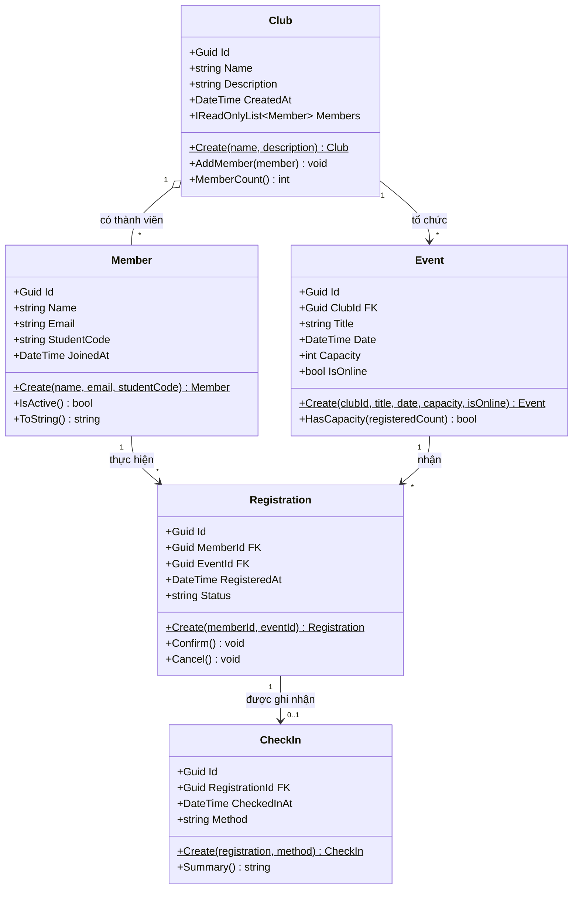

# Sơ đồ lớp sơ bộ — EduHub

Vẽ bằng Mermaid (hiển thị trực tiếp trên GitHub) hoặc xuất ảnh từ draw.io rồi đặt cạnh file này.
Ghi rõ thuộc tính chính, khoá ngoại (FK) và bội số quan hệ (1, *, 0..1).

## Giải thích

- **Club – Member (1 – \*)**: một CLB có nhiều thành viên; `Club` giữ danh sách `Members` (chỉ thêm qua `AddMember`).
- **Club – Event (1 – \*)**: một CLB tổ chức nhiều sự kiện; `Event.ClubId` là khoá ngoại tới `Club.Id`.
- **Member – Registration (1 – \*)** và **Event – Registration (1 – \*)**: `Registration` là bảng nối quan hệ nhiều–nhiều giữa Member và Event, giữ hai khoá ngoại `MemberId`, `EventId`.
- **Registration – CheckIn (1 – 0..1)**: mỗi phiếu đăng ký có tối đa một lần check-in; `CheckIn.RegistrationId` là khoá ngoại.
